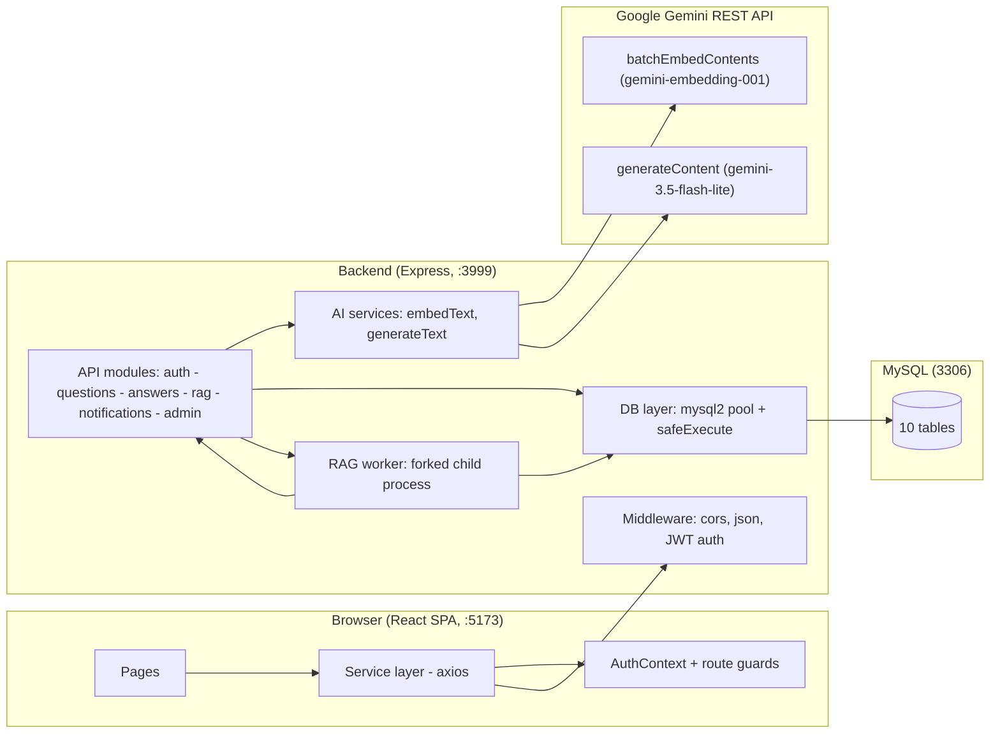
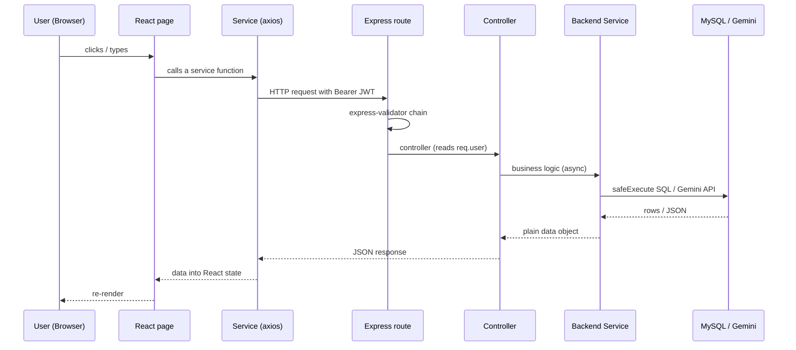

# Evangadi Forum — Code Presentation Manual

A step-by-step walkthrough of every part of the codebase and how the parts work together.

> **Stack:** React 19 + Vite (frontend) · Express 5 + MySQL (backend) · Google Gemini AI (embeddings + text).
> **Live local setup:** backend on `http://localhost:3999` (code default is 3777), frontend dev server on `http://localhost:5173`, MySQL on 3306.

## Table of contents

1. [System overview](#1-system-overview)
2. [High-level request flow](#2-high-level-request-flow)
3. [Database schema (10 tables)](#3-database-schema)
4. [Backend building blocks](#4-backend-building-blocks)
5. [Frontend structure](#5-frontend-structure)
6. [End-to-end flows (how parts work together)](#6-end-to-end-flows)
7. [Cross-cutting concerns](#7-cross-cutting-concerns)
8. [Cheat sheet: environment variables](#8-cheat-sheet-environment-variables)

---

## 1. System overview

Two independent apps share one MySQL database:

| Layer | Where | What it does |
|---|---|---|
| **Frontend** | `frontend/` | Single-page app: rendering, URL-driven search, votes, notifications, PDF preview. |
| **Backend** | `backend/` | REST API under `/api`: auth, content CRUD, AI heavy lifting, file ingestion, admin, notifications. |
| **AI** | Gemini REST | Embeddings (semantic search) and generated text (coaching, grading, RAG answers). |
| **Data** | MySQL | 10 tables covering users, content, vectors, RAG chunks, notifications. |

**Key design idea:** the frontend never talks to Gemini or MySQL directly. Every AI call and every query goes through backend services, so the UI is a pure “view + actions” layer. AI calls are also **best-effort** — a failing embedding or grade never deletes your post.



---

## 2. High-level request flow

Every user action follows the same pipeline:



**The contract in 3 words:** *validate in route → orchestrate in service → shape in controller.* Controllers never run SQL; services never touch HTTP.

---

## 3. Database schema (10 tables)

Defined in `backend/db/schema.sql`; additive upgrades live in `backend/db/migrate.js`.

| Table | Purpose | Notable columns / FKs |
|---|---|---|
| `users` | Accounts | `user_id`, `first_name`, `last_name`, `email` (unique, lowercased), `password_hash`, `role` (`user`/`admin`), `is_active` |
| `questions` | Threads | `question_id`, `question_hash` (16-hex, unique, used in URLs), `user_id` FK, `title`, `content`, FULLTEXT index for keyword search |
| `question_vectors` | AI search index | `question_id` FK (1:1), `source_text`, `embedding` JSON (3072-dim), `status` (`ready`/`failed`) |
| `answers` | Replies | `answer_id`, `question_id` FK, `user_id` FK, `content` |
| `answer_votes` | Up/down votes | PK `(user_id, answer_id)`, `vote` in (-1, 1) |
| `answer_vectors` | Answer ranking + AI grade | `answer_id` FK (1:1), `embedding`, `ai_grade` (`Good`/`Moderate`/`Low`) |
| `documents` | User PDFs (RAG) | `document_id`, `user_id` FK, `title`, `storage_path`, `byte_size`, `status` (`processing`/`ready`/`failed`) |
| `document_chunks` | Text windows of a PDF | `chunk_id`, `document_id` FK, `chunk_index`, `content` |
| `document_chunk_vectors` | Embeddings per chunk | `chunk_id` FK (1:1), `embedding`, `status` |
| `notifications` | Activity alerts | `notification_id`, `user_id` FK (recipient), `message`, `question_id` FK, `question_hash`, `is_read` |

**Relation web:** `users 1—N questions 1—N answers`; each question/answer has a 1:1 vector row; each document has 1—N chunks each with a vector; notifications point at the recipient user and the question.

**Migration philosophy:** `migrate.js` exposes idempotent `ensureXxxSchema()` functions that check `information_schema` and only create what is missing. Server boot calls them **in order**:

```text
ensureAdminSchema() → ensureAnswerVotesSchema() → ensureAnswerVectorsSchema() → ensureNotificationsSchema() → resetInterruptedDocumentsService()
```

---

## 4. Backend building blocks

All backend code lives under `backend/` and follows: `src/api/<module>/{service,controller,routes,validations}`. Shared infra sits in `src/middleware`, `src/services`, `src/utils`, `db`.

### 4.1 App bootstrap — `backend/index.js`
- Sets up CORS + JSON/urlencoded parsing.
- `GET /health` smoke check.
- Mounts `mainRouter` at `/api`, then the terminal `errorHandler`.
- `startServer()`: grabs a DB connection (exit 1 on failure), runs the migrations above, resets interrupted RAG documents, then `app.listen(port)`.

### 4.2 DB access — `db/config.js`
- `mysql2/promise` connection **pool**; `safeExecute(sql, params)` requires a params array/object, executes, returns `rows` (SELECT) or `ResultSetHeader` (writes — `.insertId`, `.affectedRows`). Every query in the app goes through it, which centralizes error behavior and connection reuse.

### 4.3 Route composition — `src/api/routes.js`
A single express `Router` that groups the six API modules:

| Base path | Module |
|---|---|
| `/api/auth` | public register/login |
| `/api/questions` | threads, search, similar, coach |
| `/api/answers` | post + vote |
| `/api/rag/documents` | knowledge base |
| `/api/notifications` | bell |
| `/api/admin` | admin (auth + admin-role guard) |

### 4.4 Middleware
- **`authentication.js`** — `authenticateUser`: parses `Bearer` JWT, verifies with `JWT_SECRET`, and stamps `req.user = { id, firstName, lastName, role }`. `authorizeAdmin`: rejects non-admin, runs after authenticate.
- **`validation-handler.js`** — runs `express-validator` results; collects messages into one `BadRequestError` (400). Appended to every validation array.
- **`error-handler.js`** — terminal middleware: reads `err.statusCode`, maps MySQL duplicate-key to 400, responds `{ msg }`.

### 4.5 Custom errors — `src/utils/errors/index.js`
`CustomAPIError` base + subclasses that each set `statusCode`:
- `BadRequestError` → 400 · `NotFoundError` → 404 · `UnauthenticatedError` → 401 · `ForbiddenError` → 403 · `ServiceUnavailableError` → 503.

Services just `throw new NotFoundError(...)`; the handler turns it into the right HTTP response.

### 4.6 AI services — `src/services/gemini.service.js` and `geminiTextCoach.service.js`

**`gemini.service.js`** is the Gemini REST client (plain `fetch` + `AbortController`; the older SDK leaked ~4 GB under quota throttling):
- `embedText(text, taskType)` → `number[]` (or `number[][]` for arrays). Batch size 100, up to 3 retries with exponential backoff, honors server `RetryInfo`, hard timeout 75 s.
- `generateText(prompt, { model, systemInstruction })` → `string`.
- `recommendAnswerGrade(questionText, answerText)` → `'Good' | 'Moderate' | 'Low'` from a supportive-moderator rubric (“when in doubt, choose higher”).
- `extractJsonFromResponse(text)` → best-effort JSON parser (fenced or bare).

**`geminiTextCoach.service.js`** builds higher-level coaches on top:
- `generateQuestionDraftCoachService` → `{ feedback, tips[] }`.
- `assessAnswerAgainstQuestionService` → `{ level, note }` (`strong`/`partial`/`weak`).
- `answerFromRagChunksService` → `{ answer, citations[], chunksUsed[] }` — forces the model to cite `ref: <chunkId>`, extracts citations as 180-char snippets, dedupes chunk ids.

All failures surface as 503 `ServiceUnavailableError`, except where a caller explicitly “best-effort” swallows them.

### 4.7 Math/search utilities — `src/utils/vector.js`
- `cosineSimilarity(a, b)` → [-1, 1]; 0 on mismatched/empty/zero vectors.
- `parseEmbedding(embedding)` → tolerant array parser (JSON string, number[], or `{values}`).
- `chunkText(text, 900, 120)` → overlapping windows that prefer sentence/newline breaks and guarantee forward progress.
- `generateHexHash(16)` → the lowercase-hex `question_hash` used in URLs.

### 4.8 Module — Auth (`src/api/auth`)
- **Routes:** `POST /api/auth/register`, `POST /api/auth/login` (public).
- **Service:** `registerService` checks duplicates, bcrypt-hashes (10 salt rounds), inserts; `loginService` verifies password + `is_active`, signs **JWT with payload `{ id, firstName, lastName, role }`**, expiry `JWT_EXPIRES_IN` (default `1d`).
- **Controller:** `register` → 201 `{ user }`; `login` → 200 `{ user, token }`. No password ever leaves the server.

### 4.9 Module — Questions (`src/api/question`)
All protected (`router.use(authenticateUser)`):

| Method & path | Purpose |
|---|---|
| `POST /api/questions` | create thread → generate hash + best-effort embedding |
| `GET /api/questions` | list, optional `search=` (keyword LIKE) and `mine=true` |
| `POST /api/questions/draft-coach` | AI draft feedback |
| `GET /api/questions/search?query=` | AI semantic search |
| `POST /api/questions/:hash/answer-fit` | AI fit check for a draft answer |
| `GET /api/questions/:hash/similar` | similar-questions sidebar |
| `GET /api/questions/:hash` | full thread (question + ranked answers) |

Core service logic in `service/question.service.js`:
- `createQuestionWithVectorService` — inserts the row, builds `sourceText = title + "\n\n" + content`, embeds it (best-effort; on failure stores `status='failed'` so posting is never blocked).
- `getSingleQuestionService` — one SQL aggregates question + answers + vote tallies + viewer’s own vote + stored `ai_grade`, then **“AI ranking”**: computes each answer’s cosine score vs the question, blends `0.5 × AI + 0.5 × normalized votes` (`rankAnswers`), and falls back to `gradeFromScore` when `ai_grade` is null (`>=0.6` Good, `>=0.45` Moderate, else Low).
- `searchQuestionsSemanticService` — embeds the query, cosine-scores all ready question vectors, filters to `SEMANTIC_SEARCH_THRESHOLD` (0.6), returns top `k` (2).
- `getSimilarQuestionsService` — same idea but lower floor (0.2) and `k` 10, excluding the source question.
- `getQuestionsService` — keyword mode using `LIKE` over title/content + optional `mine` filter, newest first.

### 4.10 Module — Answers (`src/api/answer`)
| Method & path | Purpose |
|---|---|
| `POST /api/answers` | post reply (blocked for the question author) |
| `POST /api/answers/:id/vote` | vote 1 / -1 / 0 (re-click revokes) |

`createAnswerService` does, **in order**:
1. Load question; 400 if the user is answering their own.
2. `INSERT INTO answers`; fetch the row joined with the author.
3. Embed the answer body → `answer_vectors` (best-effort, `ready`/`failed`).
4. Fire-and-forget `recommendAnswerGrade(...)` then update `ai_grade` (logged on failure).
5. **Notify the question author** — insert a `notifications` row (“Jane answered your question: <title>”), best-effort — never blocks the answer.

`voteAnswerService` upserts into `answer_votes` then recomputes up/down/net tallies plus the viewer’s vote.

### 4.11 Module — RAG Knowledge Base (`src/api/rag`)
**Upload config (`rag.upload.config.js`):** multer disk storage under `uploads/rag/<userId>/`, only `application/pdf`, max **5 MB**, one file; dedicated multer error middleware maps `LIMIT_FILE_SIZE`/`LIMIT_FILE_COUNT` to 400s.

| Method & path | Purpose |
|---|---|
| `POST /api/rag/documents` | upload (multipart `file`) |
| `GET /api/rag/documents` | my documents |
| `GET /api/rag/documents/:id` | metadata |
| `GET /api/rag/documents/:id/file` | stream the raw PDF (preview) |
| `GET /api/rag/documents/:id/search?query=` | passage search |
| `POST /api/rag/documents/:id/query` | grounded AI answer + citations |
| `DELETE /api/rag/documents/:id` | delete + unlink file |

**Ingestion pipeline** (`rag.service.js` + **forked worker** `rag.worker.js`):
1. `createDocumentFromUploadService` inserts `documents(status='processing')` and hands the id to `getRagWorker().process(documentId)`.
2. The worker is a **child process** (via `child_process.fork`) so PDF parsing + embedding never blocks the API event loop. It keeps a **serial queue**: one job at a time, terminal `done` message over IPC.
3. `processDocumentJob`: read file → parse with `pdfjs-dist` (`page.cleanup()` keeps memory flat; cap 100 pages) → fail if text < 50 chars → `chunkText(900, 120)`, cap 1000 chunks → `embedText` (batched + quota retry) → insert chunks + vectors → set `status='ready'`.
4. Any failure → `markDocumentFailed`; crash recovery marks everything stuck in `processing` as failed at boot.

**Search:** `searchInDocumentService` embeds the query, cosine-scores all ready chunk vectors, filters >=0.2, **dedupes overlapping windows** (trigram Jaccard >= 0.5 collapse), returns top `k` as `{ chunkId, chunkIndex, score, excerpt }`.

**Q&A:** `queryDocumentService` reuses the search, maps hits back to chunk content, and asks `answerFromRagChunksService` to answer *only from the retrieved passages*, citing `ref: <chunkId>` — citations are shown in the UI.

### 4.12 Module — Notifications (`src/api/notification`)
| Method & path | Purpose |
|---|---|
| `GET /api/notifications` | list (newest first) + `unreadCount` |
| `POST /api/notifications/:id/read` | mark one read (recipient-scoped) |
| `POST /api/notifications/read-all` | mark all read |

Rows are created by feature code (currently: someone answers your question). Service clamps `limit` to 1–100 and returns `{ notifications, unreadCount }`.

### 4.13 Module — Admin (`src/api/admin`)
Guarded by `authenticateUser` **and** `authorizeAdmin`.

| Method & path | Purpose |
|---|---|
| `GET /api/admin/stats` | user/question/answer/document counts + recent activity |
| `GET / PATCH / DELETE /api/admin/users` | role (admin/user), status (active), delete |
| `GET / DELETE /api/admin/questions` | list / remove (cascades answers + vector) |
| `GET / DELETE /api/admin/answers` | list / remove |
| `GET / DELETE /api/admin/documents` | list / remove (+ unlink PDF) |

Service guards: admins cannot change/delete **themselves**; all deletes are real `DELETE` (FKs cascade).

### 4.14 Operational scripts
- `scripts/create-admin.js` — `node scripts/create-admin.js <first> <last> <email> <password>`; creates or promotes a user to admin.
- `scripts/backfill-answer-ai.js` — `node scripts/backfill-answer-ai.js [--redo]`; embeds answers lacking vectors and runs the Gemini grade where missing (1 s delay between grade calls for free-tier quota).

---

## 5. Frontend structure

All frontend code lives under `frontend/src` and follows `contexts / components / pages / services / lib` with CSS Modules co-located (`X.module.css`).

### 5.1 Entry, routing, and guards
- `main.jsx` mounts `<App/>` in StrictMode.
- `App.jsx` — `<BrowserRouter><AuthProvider><Routes>`. Public: `/` (Landing), `/auth`. A **pathless `<Layout>` route** wraps all protected pages via `<Outlet/>`. Leaf routes wrap pages in `<ProtectedRoute>` (session required) or `<AdminRoute>` (admin only). Catch-all → `/`.
- `ProtectedRoute.jsx` — shows a spinner while loading, `<Navigate to='/auth' state={{from}}>` when signed out (preserves the URL for post-login redirect).
- `AdminRoute.jsx` — redirects non-admins to `/dashboard`, otherwise composes `ProtectedRoute`.

### 5.2 Auth context — `contexts/AuthContext.jsx`
- Restores the session **synchronously** from `localStorage` (`token` + `user`) on mount.
- Exposes `{ user, loading, register, login, logout, isAuthenticated }`.
- `login` stores token+user; `logout` clears them and navigates to `/auth`.

### 5.3 API client & services — `services/`
- **`core/api.client.js`** — axios instance; `baseURL = VITE_API_BASE_URL || 'http://localhost:3777'` (local `.env` → `http://localhost:3999`); request interceptor injects `Authorization: Bearer <token>`; response interceptor clears session and hard-redirects to `/auth` on 401 (except auth endpoints).
- Feature services each wrap the client: `auth`, `question`, `answer`, `rag`, `notification`, `admin`. Each returns the API `data` object, keeping pages free of axios details.

### 5.4 App shell — `components/`
- **`Layout/Layout.jsx`** — sidebar + main column + footer; derives the navbar title/subtitle from `location.pathname`.
- **`Sidebar/Sidebar.jsx`** — `<NavLink>` items: Home, Your Topics, Knowledge Base (+ Admin Panel when `role==='admin'`); “New Question” footer button; user card + logout.
- **`Navbar/Navbar.jsx`** — URL-driven search (`?q=` keyword debounced at 500 ms, `?semantic=` AI search when 3+ chars, semantic mode never clobbered by the keyword debounce), plus the **notification bell** (badge capped at “9+”, dropdown with relative timestamps, optimistic read, “Mark all read”, **20 s polling** while signed in).
- **`QuestionCard/QuestionCard.jsx`** — shared clickable card; optional `highlight` prop wraps matched words in `<mark>` (longest-term-first regex) — used by both keyword and semantic search.
- **`RagAnswerBody/RagAnswerBody.jsx`** — shared react-markdown renderer (styled headings/lists/code; fenced code blocks get language label + copy button).

### 5.5 Public pages
- **`Landing/Landing.jsx`** — marketing page; CTAs adapt to signed-in state; scroll sections for the RAG pipeline and “how it works”.
- **`Auth/Auth.jsx`** — combined login/register (in-memory toggle, no role toggle). On login success, redirects to `location.state.from` or `/dashboard`.

### 5.6 Forum pages
- **`Dashboard/Dashboard.jsx`** — home feed. Source of truth is the URL query: `semantic` → `searchQuestionsSemantic`, else `q` → keyword `getQuestions({search})`, else latest feed. Renders `QuestionCard` with `highlight={semantic || keyword}`.
- **`MyQuestions/MyQuestions.jsx`** — `getQuestions({ mine:true })` list, empty-state CTA to ask.
- **`PostQuestion/PostQuestion.jsx`** — title/content form; optional AI draft coach; on success navigates to **`/questions/:questionHash`** returned by the API.
- **`QuestionDetail/QuestionDetail.jsx`** — thread page: fetches `getSingleQuestion(hash)`. Renders question + answers with vote buttons (separate up/down counts, re-click revokes), Gemini grade chip, answer form + “Check answer fit” (both **hidden for the question author**, who instead sees a notice). Posting an answer prepends it to local state.

### 5.7 Knowledge Base page — `pages/RagDocuments/RagDocuments.jsx`
- Left: doc list with status pills. Right: three tabs once a doc is `ready` — **Ask AI** (grounded answer + citations), **Search** (passage hits with excerpt), **Preview** (PDF via object URL, revoked on change to avoid leaks).
- Uploads enforce PDF + 5 MB client-side, report progress %, then auto-select the new doc.
- While any doc is `processing`, the page **polls every 2 s** until a terminal status (the heavy work happens in the backend worker).

### 5.8 Admin pages — `pages/Admin/`
- `AdminDashboard` — stat cards + recent activity.
- `AdminUsers/AdminQuestions/AdminAnswers/AdminDocuments` — tables with actions (role-toggle, activate/deactivate, delete), each wired to `adminService` and reloading after every mutation. Self-rows are disabled.

### 5.9 Shared utilities
- `lib/utils.js` — `timeAgo`, `isAuthoredByUser`, `getErrorMessage`.
- `styles/pageStates.module.css` — shared loading/error/empty visual patterns.
- `index.css` — global design tokens (orange primary, spacing/radius/shadow scales, Inter font), app-shell widths.

---

## 6. End-to-end flows (how parts work together)

### 6.1 Registration & login (JWT)
1. `Auth.jsx` → `authService.register({firstName,lastName,email,password})` → `POST /api/auth/register`.
2. Route validations → `registerService`: lowercases email, rejects duplicates, bcrypt-hashes, inserts.
3. User signs in → `POST /api/auth/login` → password compared → JWT signed → `{user, token}` returned.
4. `AuthContext.login` stores `token` + `user` in localStorage; redirect to original destination.
5. Every later request auto-attaches the token via the axios interceptor; `authenticateUser` verifies it and injects `req.user`. Expired/invalid → 401 → interceptor boots to `/auth`.

### 6.2 Posting a question → embedding
1. `PostQuestion.jsx` (optional draft coach first) → `POST /api/questions` → validations (title 5–255, content >=10).
2. `createQuestionWithVectorService`: insert row with a unique 16-hex `question_hash`; embed `title` + `content`; store vector (best-effort `ready`/`failed`).
3. Response carries `questionHash` → the UI routes to `/questions/:hash`.

### 6.3 Answering → grading + notification
1. A different user opens the thread → `QuestionDetail` posts → `POST /api/answers` (own-answer blocked server-side + hidden form client-side).
2. `createAnswerService`: insert → embed answer (best-effort) → background Gemini grade updates `ai_grade` → insert `notifications` row for the question owner.
3. The owner’s navbar bell polls `/api/notifications` every 20 s and shows the badge; clicking navigates to the thread and marks it read.

### 6.4 Semantic search (Dashboard “AI Search”)
1. Navbar → `/dashboard?semantic=...` (3+ chars).
2. `Dashboard` → `searchQuestionsSemantic` → `GET /api/questions/search?query=`.
3. Service embeds the query (`RETRIEVAL_QUERY`), cosine-scores all ready `question_vectors`, keeps >=0.6, top 2.
4. Matched `QuestionCard`s highlight the query words with `<mark>`.

### 6.5 Similar-question sidebar
Same machinery as above but: source question’s own vector is the query; excludes itself; lower threshold 0.2; `k=10`. (Endpoint: `GET /api/questions/:hash/similar`.)

### 6.6 AI draft coach & answer-fit coach
Pure `generateText` calls with a “reply in JSON only” system prompt: `PostQuestion` shows `feedback` + `tips[]`; `QuestionDetail` shows a fit level (`strong`/`partial`/`weak`) + note. Both have long axios timeouts (120 s) because free-tier quota can be slow, and both degrade to friendly messages on failure.

### 6.7 RAG upload → worker → search / Q&A
1. `RagDocuments` uploads a PDF → `documents(status='processing')`; worker job is enqueued in the forked child process.
2. Worker parses (pdfjs), chunks (900/120), embeds each chunk, stores vectors, flips status to `ready`.
3. UI polls every 2 s until terminal; tabs enable.
4. **Search:** query → top-k deduped passages (threshold 0.2).
5. **Q&A:** same retrieval → `answerFromRagChunksService` → grounded answer + citation snippets + chunk count displayed under the answer.

### 6.8 Notification bell (polling)
1. Navbar loads `getNotifications({limit:20})` on mount and every 20 s.
2. Unread badge (`9+` cap); dropdown refreshes when opened, closes on outside click.
3. Click → optimistic mark-read + navigate to `/questions/:hash`; “Mark all read” zeroes the badge and calls the API.

---

## 7. Cross-cutting concerns

| Concern | How it’s handled |
|---|---|
| **Auth** | JWT payload `{id,firstName,lastName,role}`; `is_active` checked at login; admin double-guarded. |
| **Ownership** | Every “my thing” query filters by `req.user.id`; rag asserts ownership before serving files. |
| **AI resilience** | Embeddings/grades are best-effort; failures log and degrade (vector `status='failed'`, live fallback grading, “unavailable right now” UI). Gemini calls retry with backoff and a 75 s cap. |
| **Heavy work** | PDF parsing/embedding runs in a forked worker with a serial queue; the API stays responsive and the UI polls status. |
| **Search tuning** | Two thresholds: strict (0.6, k=2) for user-facing semantic search; lenient (0.2, k=10) for recommendation; dedupe via trigram overlap in RAG. |
| **Consistency** | FKs cascade deletes (user/admin removal), `safeExecute` central query path, idempotent migrations at boot. |
| **Errors** | Bottom-up: services throw typed errors → error-handler serializes `{statusCode,msg}` → frontend `getErrorMessage`. |

---

## 8. Cheat sheet: environment variables

**Backend (`backend/.env`)** — core: `PORT`, `DB_HOST`, `DB_USER`, `DB_PASS`, `DB_NAME`, `JWT_SECRET`, `JWT_EXPIRES_IN`.

**Backend — AI:** `GEMINI_API_KEY`, `GEMINI_EMBEDDING_MODEL`, `GEMINI_TEXT_MODEL`, `GEMINI_BASE_URL`, `EMBED_BATCH_SIZE`, `GEMINI_EMBED_MAX_RETRIES`, `GEMINI_EMBED_RETRY_BASE_MS`, `GEMINI_REQUEST_TIMEOUT_MS`.

**Backend — search/ranking:** `RECOMMEND_THRESHOLD`, `RECOMMEND_K`, `SEMANTIC_SEARCH_THRESHOLD`, `SEMANTIC_SEARCH_K`, `ANSWER_RANK_AI_WEIGHT`, `ANSWER_RANK_VOTE_WEIGHT`, `ANSWER_GOOD_MIN`, `ANSWER_MODERATE_MIN`.

**Backend — RAG:** `RAG_SEARCH_THRESHOLD`, `RAG_SEARCH_K`, `RAG_CHUNK_CHARS`, `RAG_CHUNK_OVERLAP`, `RAG_MAX_CHUNKS_PER_DOC`, `RAG_MAX_PDFS_PER_USER`, `RAG_MIN_TEXT_CHARS`, `RAG_MAX_PARSE_PAGES`, `RAG_UPLOAD_DIR`, `RAG_MAX_UPLOAD_MB`.

**Frontend (`frontend/.env`):** `VITE_API_BASE_URL=http://localhost:3999` (the code default is 3777 — the live `.env` overrides it).